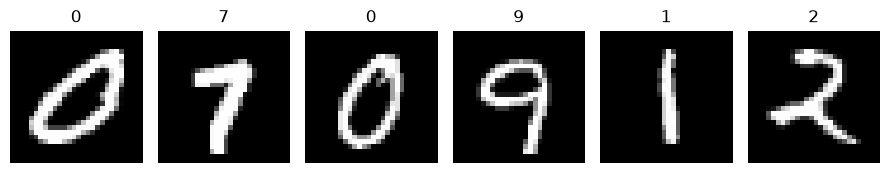
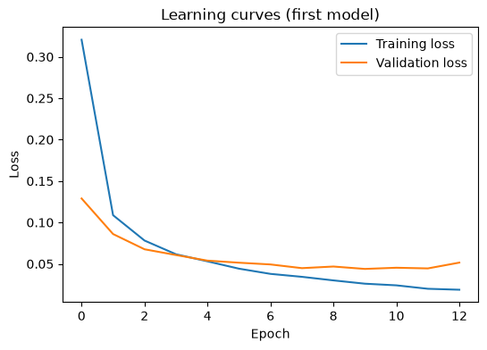
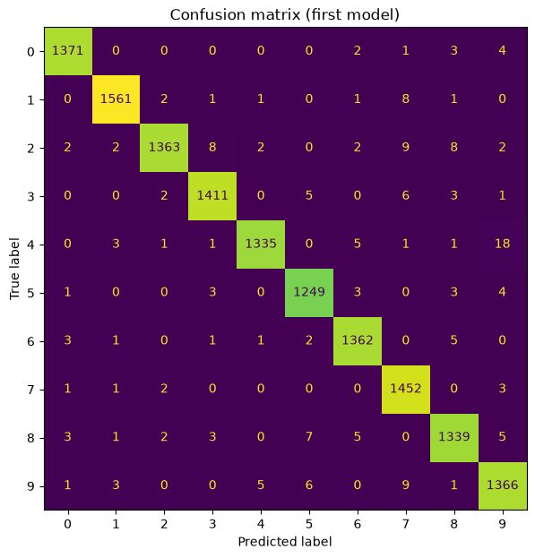

# Where does a CNN misread handwritten digits?

A small convolutional neural network reads the MNIST digits with 98.6% test accuracy. This project looks at the images it gets wrong, and tests whether one change to the network moves those mistakes.

**Course:** Machine Learning with Python, final project, Option 1  
**Author:** Dimitris Karapidakis  
**Date:** October 2026

## Files in this repository

| File | What it is |
|---|---|
| `mnist_cnn_error_analysis.ipynb` | The completed project notebook, with every cell run and all outputs visible |
| `mnist_cnn_error_analysis.html` | The same notebook exported as a web page, for reading without Jupyter |
| `images/` | Figures taken from the notebook |

## 1. Problem

Software that reads handwritten numbers, such as postcodes on envelopes or account numbers on forms, has to be judged on where it goes wrong and not only on how often it is right, because a confident misreading sends a letter or a payment to the wrong place.

The central question of the project is: **where does the CNN make its mistakes, and does one change to the model move them?**

## 2. Data

The data set is MNIST, downloaded from OpenML: 70,000 greyscale images of handwritten digits, each 28 by 28 pixels, labelled 0 to 9.

Each image was reshaped to 28 × 28 × 1 and the pixel values were scaled from 0–255 to 0–1. The data were split into 56,000 training images and 14,000 test images, keeping the same share of each digit in both sets.

## 3. Method

**First model.** A Keras Sequential network with one convolutional block:

1. `Conv2D` with 32 filters and a 3 × 3 window (ReLU)
2. `MaxPooling2D` with a 2 × 2 window
3. `Dropout` of 0.3
4. `Flatten`
5. `Dense` with 64 units (ReLU)
6. `Dense` with 10 units (softmax), one per digit

It was compiled with the Adam optimiser and sparse categorical cross-entropy, and trained with a batch size of 128 for up to 15 epochs. Ten percent of the training images were held back for validation, and early stopping (patience 3, restoring the best weights) ended training after 13 epochs.

**One change.** I chose Option A, a deeper network: a second block of `Conv2D` (64 filters, 3 × 3) and `MaxPooling2D` before the `Flatten` layer. Everything else, including the random seed and the training settings, was kept the same so that any difference comes from that one change.

Before running it I predicted that the test accuracy would go up slightly, by a few tenths of a percentage point, because a second convolutional layer can combine the simple edges found by the first layer into larger shapes such as loops and closed tops. I also expected the counts for both confusion pairs to fall.

## 4. Results

| | First model | Second model (deeper) |
|---|---|---|
| Test accuracy | 98.64% | 98.62% |
| Wrong test images out of 14,000 | 191 | 193 |
| True 4 predicted as 9 | 18 | 11 |
| True 9 predicted as 7 | 9 | 8 |

**First model**

**Second model**

In the first model, by far the most common confusion is a true 4 predicted as 9 (18 images). The next is a true 9 predicted as 7 (9 images), tied with 2 predicted as 7.

## 5. Interpretation

My first model made most of its mistakes on digits whose shapes overlap. A 4 written with a closed top looks almost exactly like a 9, and a 9 with a small or open loop and a straight stem is very close to a 7, so in both pairs a few pixels at the top of the digit decide the answer.

My prediction was only partly correct. The deeper network did **not** raise the test accuracy: it scored 98.62% against 98.64%, a difference of two images that is well within the randomness of training. It did, however, move the mistakes. The 4 → 9 confusion fell from 18 to 11, while 9 → 7 barely changed, going from 9 to 8. The total number of errors stayed the same, so the extra convolutional layer helped the model separate open from closed tops on 4s and 9s, but it made a similar number of new mistakes elsewhere.

**Limitations.** The drop from 18 to 11 is the only change large enough to suggest a real effect, and even that comes from one training run with a single seed. MNIST was collected mostly from American Census Bureau staff and high-school students, so people who write digits differently are under-represented: the European 1 with a long upstroke, the crossed 7, children, older people and people with motor impairments. In a postcode or account-number pipeline, a confident but wrong reading is worse than a refusal, because nobody checks it. A real system should send low-confidence predictions to a human and should be tested on handwriting from the people who will actually use it.

## 6. Reflection

What worked well was reading the confusion matrix by pairs: it turned one accuracy number into a short list of specific, explainable mistakes.

The difficult part was judging whether a difference is real. Two models that differ by two images out of 14,000 are not meaningfully different, and a single cell changing by a few images can be noise.

With more time I would retrain both models with several seeds and compare the average counts, to confirm whether the fall in the 4 → 9 confusion is a real effect of the deeper network.

## How to run the notebook

Open `mnist_cnn_error_analysis.ipynb` in Google Colab or Jupyter and run all cells from top to bottom. The MNIST data set downloads automatically the first time, so an internet connection is needed. Training takes a few minutes on a laptop.
